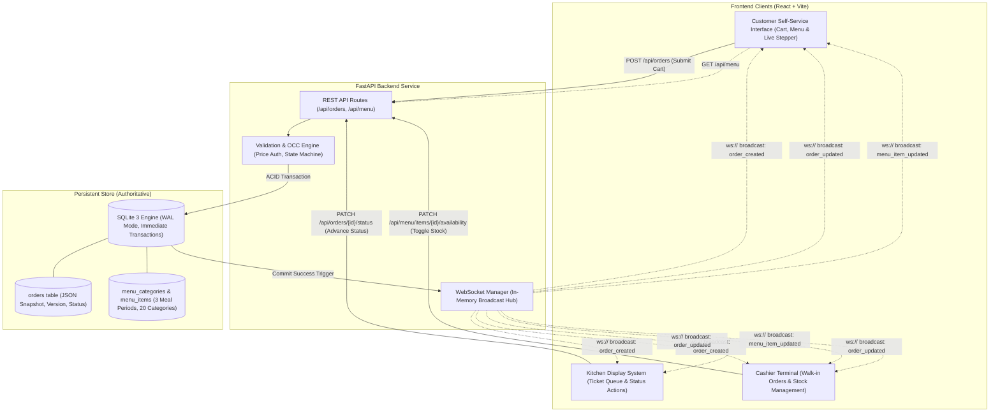
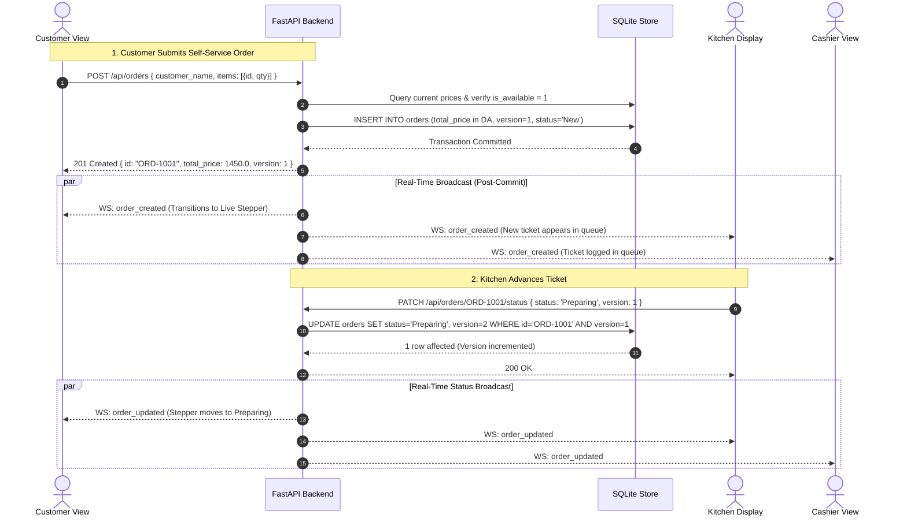
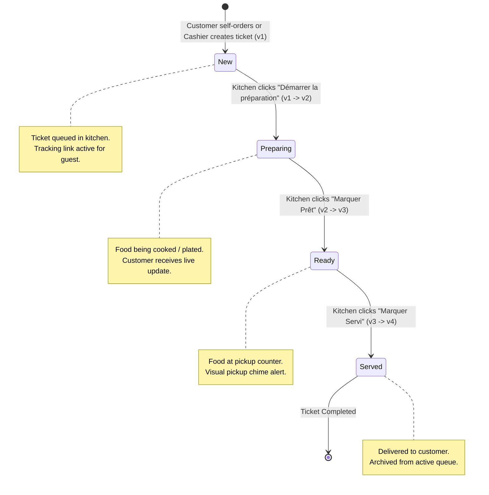

<div align="center">

# 🍽️ Real-Time Restaurant Order Management & Customer Self-Service System

**An event-driven restaurant management application featuring authoritative state synchronization, customer self-service ordering, and optimistic concurrency control across distributed role interfaces.**

[](https://www.python.org/)
[](https://fastapi.tiangolo.com/)
[](https://react.dev/)
[](https://vitejs.dev/)
[](https://www.sqlite.org/)
[](https://developer.mozilla.org/en-US/docs/Web/API/WebSockets_API)
[](https://docs.pytest.org/)

[Key Features](#-key-features) • [System Architecture](#-system-architecture) • [Real-Time Flow](#-real-time-synchronization-flow) • [Menu Hierarchy](#-restaurant-menu-hierarchy) • [Concurrency Control](#-concurrency-control--occ) • [Quick Start](#-getting-started) • [API Reference](#-api-reference)

</div>

---

## 🌟 Key Features

The application provides three specialized web interfaces sharing one authoritative SQLite datastore and an in-memory WebSocket event bus:

| Interface | Primary Users | Key Capabilities |
| :--- | :--- | :--- |
| **📱 Customer View** | Guests & Walk-ins | Browse 3 meal periods (20 strict categories), interactive shopping cart, server-validated orders in Algerian Dinars (`DA`), and live 4-stage tracking stepper with real-time updates. |
| **🍳 Kitchen Display (KDS)** | Kitchen Staff & Chefs | Live active ticket queue, 1-click lifecycle advancement (`New → Preparing → Ready → Served`), optimistic concurrency conflict detection, and immediate broadcast on prep completion. |
| **💳 Cashier Terminal** | Front Counter & Cashiers | Walk-in manual ticket entry, shareable tracking link generator, order queue review, and live menu stock toggling (`In Stock` ↔ `Out of Stock`). |

### Engineering Highlights
- **Authoritative Server Calculations**: Client-submitted totals are never trusted. The backend verifies item availability and calculates line totals and grand totals authoritatively in **Algerian Dinars (DA)**.
- **Historical Order Snapshots**: When an order is placed, an immutable snapshot of item names, unit prices, quantities, and line totals is saved. Future menu updates never alter past receipts.
- **Transactional Post-Commit Broadcasting**: WebSockets only broadcast events after the SQLite transaction has committed to disk.
- **Optimistic Concurrency Control (OCC)**: Atomic conditional SQL updates eliminate race conditions when multiple staff members advance tickets simultaneously.
- **Full Multi-Device Responsiveness**: Fluid layouts engineered for smartphones (320px–480px), tablets (768px–1024px), laptops, and large desktop screens.

---

## 🏗️ System Architecture



---

## ⚡ Real-Time Synchronization Flow



---

## 🔄 Order Lifecycle & Concurrency (OCC)



### Optimistic Concurrency Control
To prevent race conditions when multiple users manipulate tickets simultaneously:
1. Every order carries an incremental integer `version` (initialized to `1`).
2. Update requests submit the known version: `{ "status": "Ready", "version": 2 }`.
3. The backend executes an atomic conditional SQL statement:
   ```sql
   UPDATE orders
   SET status = ?, version = version + 1
   WHERE id = ? AND version = ?;
   ```
4. If another staff member updated the order first, `rowcount` equals `0`. The backend rejects the stale request with **HTTP 409 Conflict** and returns the latest order state so the client reconciles without data loss.

---

## 📋 Restaurant Menu Hierarchy

The demonstration menu adheres to 3 meal periods and their exact 20 canonical categories, featuring French and Algerian culinary dishes with prices in **Algerian Dinars (DA)**:

| Meal Period | Category Order | Canonical Category Name | Sample Demonstrative Dishes (DA) |
| :--- | :---: | :--- | :--- |
| **🌅 Breakfast** | 1 | `Beverages / Liquid Start` | Jus d'Orange Pressé (350 DA), Café Crème Kahwa (250 DA) |
| | 2 | `Fruit & Bakery` | Msemen Beurre & Miel (400 DA), Croissant Artisanal (350 DA) |
| | 3 | `Cereals & Grains` | Tamina Dorée aux Amandes (500 DA), Gruau Dattes Deglet Nour (450 DA) |
| | 4 | `Main Plates` | Chakchouka Traditionnelle aux Œufs (750 DA), Omelette Khlii (850 DA) |
| **🥗 Lunch** | 1 | `Appetizer / Starter` | Bourek Viande Hachée (650 DA), Salade Méchouia Braisée (600 DA) |
| | 2 | `Main Course` | Couscous Royal Agneau (1 950 DA), Tajine Zitoun Poulet (1 650 DA) |
| | 3 | `Sides` | Frites Maison aux Épices (400 DA), Batata Chtitha (450 DA) |
| | 4 | `Dessert` | Crème Caramel Fleur d'Oranger (500 DA), Fondant Chocolat Noir (650 DA) |
| **🍷 Dinner & Full-Course** | 1 | `Hors d’œuvre` | Mini Pastillas Poulet & Amandes (850 DA), Feuillantine Crevettes (900 DA) |
| | 2 | `Amuse-bouche` | Velouté Glacé Courgettes Menthe (450 DA), Canapé Sardines (500 DA) |
| | 3 | `Soup` | Chorba Frik Agneau (850 DA), Chorba Beida Blanche Poulet (800 DA) |
| | 4 | `Appetizer / Starter` | Foie Gras Poêlé aux Figues (1 800 DA), Tartare de Thon Rouge (1 500 DA) |
| | 5 | `Salad` | Salade Agrumes & Roquette (750 DA), Salade Tomates & Olives (700 DA) |
| | 6 | `Fish / Seafood Course` | Pavé de Loup de Mer au Fenouil (2 400 DA), Gambas Royales (2 600 DA) |
| | 7 | `Palate Cleanser` | Sorbet Givré Citron & Menthe (400 DA), Granité Clémentine (450 DA) |
| | 8 | `Main Course` | Chakhchoukha de Biskra Agneau (2 200 DA), Souris d'Agneau Confite (2 500 DA) |
| | 9 | `Cheese Course` | Sélection Brebis & Chèvre (1 100 DA), Fromage Frais Zaatar (950 DA) |
| | 10 | `Dessert` | Mille-Feuille Vanille Praliné (850 DA), Tartelette Fraises Pistache (800 DA) |
| | 11 | `Mignardises / Petit Fours`| Trio Pâtisseries Baklawa/Samsa (650 DA), Truffes Chocolat (550 DA) |
| | 12 | `Digestif & Beverages` | Thé à la Menthe aux Pignons (350 DA), Infusion Verveine (300 DA) |

---

## 📱 Responsive Multi-Device Design

The application is responsive across different device viewports:

| Device | Breakpoint | Responsive Behaviors |
| :--- | :--- | :--- |
| **Mobile** | `< 480px` | Single-column stacked tickets, full-width touch targets (minimum 44px), horizontally swipeable meal-period tabs, and sticky cart action bar. |
| **Tablet** | `768px – 1024px` | Dual-column KDS grid, fluid 2-column cashier layout, and optimized typography for touchscreens. |
| **Desktop** | `> 1024px` | Side-by-side cashier orders queue and walk-in form; sticky shopping cart panel pinned alongside category items; multi-column kitchen ticket grid. |

---

## 🔌 API Reference

### Menu Endpoints
- `GET /api/menu`: Returns structured 3-period menu with 20 ordered categories and items.
- `GET /api/menu/items`: Returns flat list of all menu items.
- `PATCH /api/menu/items/{id}/availability`: Toggles item availability and broadcasts `menu_item_updated`.

### Order Endpoints
- `GET /api/orders`: Retrieves all orders sorted by creation time descending.
- `GET /api/orders/{id}`: Retrieves single order by alphanumeric ID (e.g. `ORD-1001`).
- `POST /api/orders`: Creates self-service or walk-in order; validates items, availability, and calculates prices authoritatively in `DA`; broadcasts `order_created`.
- `PATCH /api/orders/{id}/status`: Advances status using OCC version check; broadcasts `order_updated`.
- `WS /ws`: Bi-directional real-time WebSocket connection.

---

## 🚀 Getting Started

### Prerequisites
- **Python 3.10+**
- **Node.js 18+** and **npm**

### 1. Backend Service Setup (PowerShell)
```powershell
cd backend
python -m venv .venv
.venv\Scripts\Activate.ps1
pip install -r requirements.txt

# Start FastAPI server on port 8000
uvicorn app.main:app --host 127.0.0.1 --port 8000 --reload
```
- API endpoints: `http://127.0.0.1:8000`
- Interactive Swagger docs: `http://127.0.0.1:8000/docs`

### 2. Frontend Application Setup (PowerShell)
```powershell
cd frontend
npm install

# Start Vite development server
npm run dev
```
- Web Application: `http://localhost:5173`

---

## 🌐 Role Direct URLs

| Role | Direct URL | Description |
| :--- | :--- | :--- |
| **Customer (Self-Order)** | [http://localhost:5173/?role=customer](http://localhost:5173/?role=customer) | Default view: Browse French/Algerian menu, build cart, place order. |
| **Customer Tracking** | [http://localhost:5173/?role=customer&orderId=ORD-1001](http://localhost:5173/?role=customer&orderId=ORD-1001) | Live 4-stage tracking stepper for order `ORD-1001`. |
| **Kitchen Display (KDS)** | [http://localhost:5173/?role=kitchen](http://localhost:5173/?role=kitchen) | Active ticket queue with one-click status advancement. |
| **Cashier Terminal** | [http://localhost:5173/?role=cashier](http://localhost:5173/?role=cashier) | Walk-in order creation and live menu stock toggling. |

---

## 🧪 Verification & Testing

```powershell
# Run the complete test suite (18 unit & integration tests)
backend\.venv\Scripts\pytest backend\tests -v

# Run the live multi-client end-to-end WebSocket & OCC simulation
backend\.venv\Scripts\python backend\tests\e2e_simulation.py

# Verify production frontend build
cd frontend; npm run build
```
